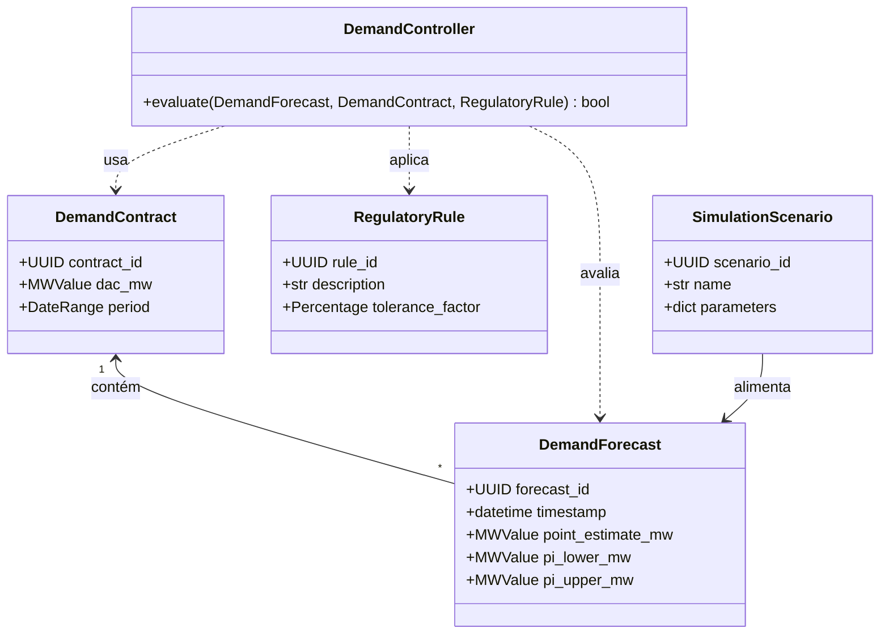

# DOMAIN_MODEL.md

## Modelo de Domínio

Define entidades, value objects e diagramas de classes essenciais ao SmartDemandLab, alinhado aos princípios SOLID.

### Entidades

| Entidade | Atributos principais | Relacionamento |
|----------|----------------------|----------------|
| **DemandContract** | `contract_id: UUID`, `dac_mw: float`, `period: DateRange` | contém `DemandForecast` |
| **DemandForecast** | `forecast_id: UUID`, `timestamp: datetime`, `point_estimate_mw: float`, `pi_lower_mw: float`, `pi_upper_mw: float` | referencia `DemandContract` |
| **RegulatoryRule** | `rule_id: UUID`, `description: str`, `tolerance_factor: float` (ex.: 1.05) | usada por `DemandController` |
| **SimulationScenario** | `scenario_id: UUID`, `name: str`, `parameters: dict` | alimenta `DemandForecast` |

### Value Objects (imutáveis)

- **MWValue** – encapsula `float >= 0`.

- **Percentage** – `float` entre 0 e 1.

- **DateRange** – `start: date`, `end: date`.

### Diagrama de Classes (UML)

### Regras de Negócio

1. O consumo real nunca excede `dac_mw`.

2. O limite superior do PI (`pi_upper_mw`) é comparado com `dac_mw * tolerance_factor` apenas para avaliação de risco regulatório.

3. Todos os forecasts utilizam intervalos de 99 % obtidos via Conformal Prediction.

4. Value Objects são imutáveis para garantir consistência.

*Documentado em `docs/DOMAIN_MODEL.md` e atualizado conforme novas entidades.*
